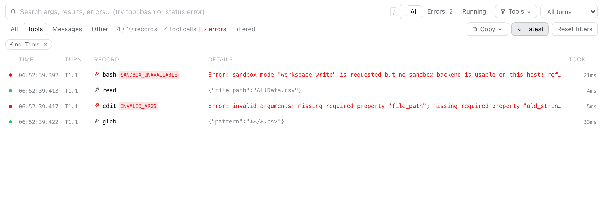

# Better Trajectory

给 DeepSeek Harness 原生「轨迹」加一层可筛选、可搜索的调试视图：按**工具名**、**错误**、**回合**、**类型**或**全文**收敛记录，再查看单条的完整参数与结果。

原生「轨迹」页签保留不动；本插件在旁边加一个 **Trajectory+** 页签，读同一份轨迹快照。



## 它解决什么

原生轨迹擅长「按时间顺序看发生了什么」，但调试时经常是反过来的：

- 这次会话里 `bash` 到底被调了几次、每次参数是什么？
- 哪些工具报错了？错误码 / 错误原文是什么？
- 某个工具的输出里有没有出现某个路径、某个错误串？
- 第 3 回合发生了什么？把消息和上下文先滤掉。

Better Trajectory 把这些变成工具栏上的几个点击，或者搜索框里的一条 `tool:bash status:error`。

## 用起来什么样

### 筛选

- **状态**：全部 / 错误 / 运行中，带实时计数。
- **类型**：全部 / 工具 / 消息 / 其他；上下文、命令、压缩、重试、回合错误归在「其他」。
- **工具**：按工具名多选，带调用次数；已选工具在切换状态筛选时不会从列表里消失。

  
- **回合**：按回合收敛，工具行也会落到它所属的回合（不再显示 `—`）。
- 多个维度叠加；工具栏顶部显示当前生效的筛选胶囊，点 × 单独移除。

### 搜索语法

搜索框对参数、结果、错误文本和工具名做大小写不敏感的子串匹配。支持：

| 写法 | 含义 |
|---|---|
| `bash` | 全文包含 `bash` |
| `"no such file"` | 精确短语 |
| `tool:bash` | 工具名匹配（结尾 `*` 可做前缀匹配） |
| `status:error` | 状态（也接受 `ok` / `running` / `interrupted`） |
| `kind:tool` | 类型（也接受 `assistant` / `user` / `context` / `error` / `command`） |
| `turn:3`、`turn:>=3`、`turn:2-4` | 回合数字与范围 |
| `step:2` | 步骤 |
| `ms:>1000` | 工具耗时（毫秒） |
| `id:toolu_...` | 调用 ID 前缀 / 子串 |
| `code:ENOENT` | 错误码 / 错误名 |
| `-tool:read` | 排除 |

不同字段之间是 AND，同一字段的多个值是 OR；`-` 前缀取反。按 `/` 聚焦搜索框，`Esc` 清空。

### 详情

点任意一行打开右侧详情：时间、回合 / 步骤、耗时、调用 ID、父调用、Token；错误身份与原文；完整参数（JSON 自动缩进）；完整结果。结果可以切换格式化 / 原始文本，参数和结果各有复制按钮。


### 带走证据

- **复制为 Markdown**：表格 + 所有失败记录的参数 / 结果，直接贴进 issue。
- **复制为 JSON**：结构化记录，方便再用脚本处理。
- **下载 JSON**：落一份可归档的调试快照。
- 工具栏的「最新」在浏览历史时不会强制跟随；滚回底部后恢复自动跟随。
- 筛选状态按会话记住（`sessionStorage`），切到「对话」再回来还在。

## 安装

GUI：打开 **Plugins → Add plugin**，填入包名或仓库地址。

CLI（web profile）：

```sh
# 已发布到 npm 时
dsh plugin --profile web add dsh-better-trajectory

# 从 GitHub 安装（产物已入库，不需要在用户机器上构建）
dsh plugin --profile web add github:vlln/dsh-better-trajectory

# 本地开发目录
dsh plugin --profile web add /path/to/dsh-better-trajectory
```

安装后刷新页面。在会话顶部页签里选择 **Trajectory+**；它会和「对话」「轨迹」并列。

卸载：

```sh
dsh plugin --profile web remove dsh-better-trajectory
```

也可以在 Plugins 页停用本插件，原生「轨迹」不受影响。

## 兼容性

- 实测：DeepSeek Harness **0.2.2-rc.2**（2026-11-14），web profile，React 18.3。
- 依赖内置的 `@deepseek-ai/dsh-client-ui-trajectory` 提供的 `useTrajectory` 会话 hook 与 `trajectory` 快照 target；它随 web-app 一起分发。若该插件被禁用，本页签会显示「读不到轨迹数据」而不是崩溃。
- 声明支持 `dsh >= 0.2.2-rc.1 < 0.3.0`；更早的 0.2.1 未实测，不标为已验证。
- Desktop 与 web 共用同一个客户端，但 Desktop 未单独实测。

## 插件管理

- 安装 / 卸载命令见上；本地目录用 `link:` 安装，改完源码后 `npm run build`，再刷新页面。
- 本插件没有宿主侧配置项，不在设置页占卡片。
- 版本号、构建产物（`lib/client.js`）与变更记录见 `CHANGELOG.md`。

## 边界与隐私

- **只读**：不写会话事件、不改原生轨迹数据；所有筛选都在浏览器内存里完成。
- **范围是已加载窗口**：历史很长时，列表顶部提供「加载更早的记录」；没有加载的部分不参与筛选。
- **全文索引上限**：单条记录只把前 48k 字符放进搜索索引（参数 / 结果 / 错误仍完整保留在详情与复制里），避免一次会话把内存吃满。
- **没有时间轴**：原生轨迹的时长概览仍由原生页签提供；本页签专注于「筛选 + 详情」。
- **图片**：结果里的图片以 `[image]` 占位，不渲染预览；文本、JSON、错误信息完整保留。
- **网络**：不发起任何请求；复制 / 下载由用户手动触发。
- **数据位置**：全部留在当前页面与会话存储；不会上传到任何地方。

## 开发

```sh
pnpm install --offline     # 依赖 store 已有 esbuild / typescript / @types/react
npm run build              # 构建 lib/client.js
npm test                   # 纯数据层单测（行投影 / 查询 / 筛选 / 导出）
npm run typecheck          # tsc --noEmit
npm run verify             # 上面三步 + 语法检查
```

结构：

- `src/client/rows.mjs` — 把轨迹快照投影成扁平记录，查询解析与筛选。
- `src/client/export.mjs` — Markdown / JSON 导出。
- `src/client/view.tsx` — 页签 UI。
- `src/client/index.tsx` — 注册 `conversation.view` 页签、文案与样式。
- `index.mjs` — 宿主侧空 apply（bundle 的 insert 行需要一个 Cordis 插件）。

详细的工程约束见 `AGENTS.md`。
