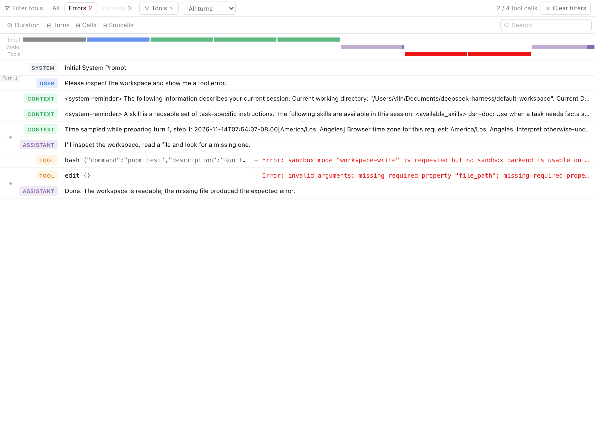
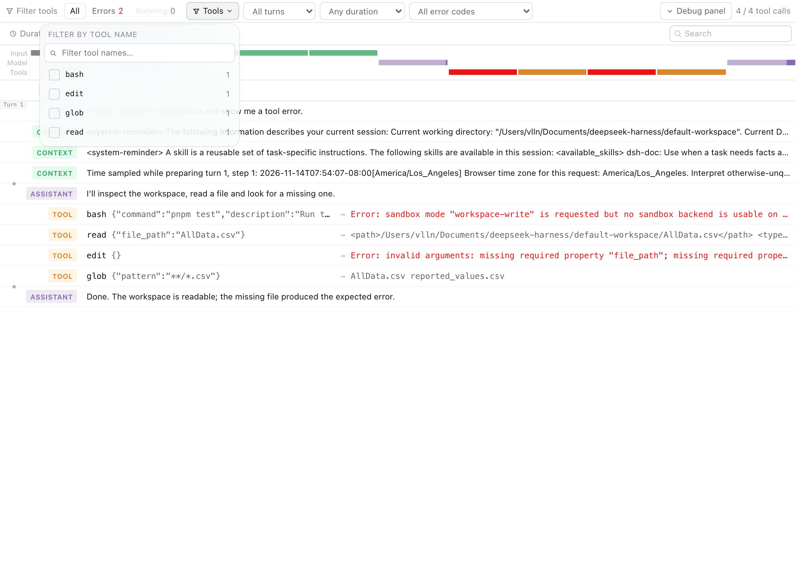
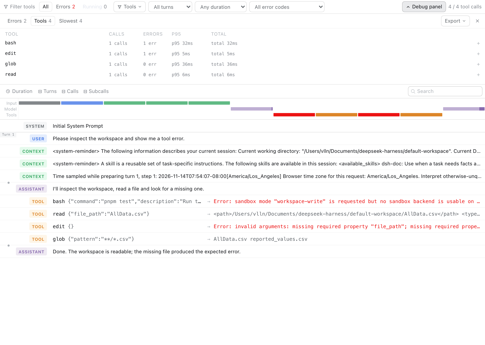
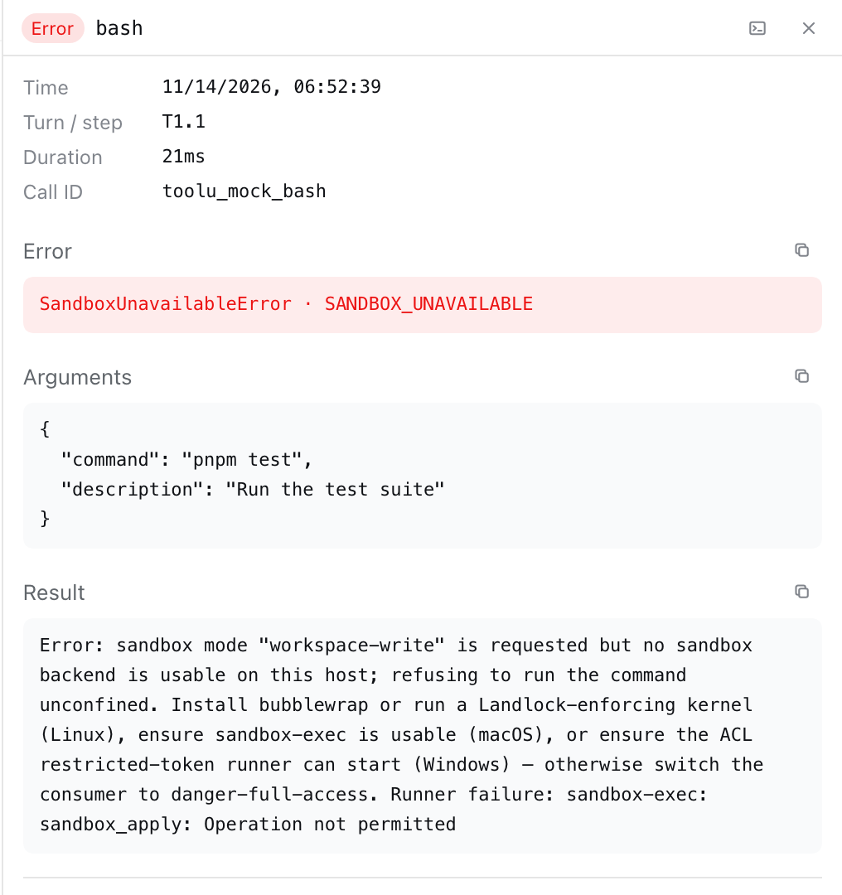
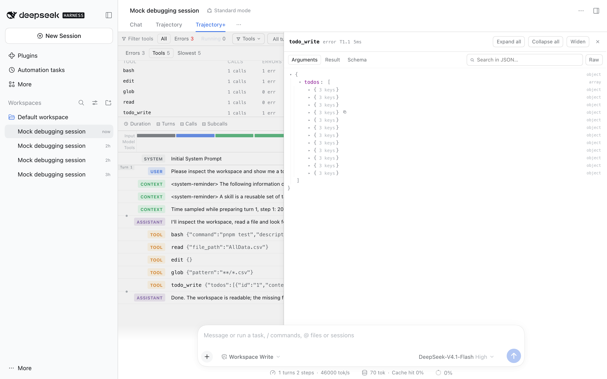

# Better Trajectory

原生「轨迹」的**超集**：还是同一个 `TrajectoryView`——原生时间轴、折叠、搜索、详情、Schema、Timing 全在——上方只加筛选栏和调试面板。



## 为什么不是另一套轨迹 UI

上一版自己重画了一张表，丢了原生时间轴、折叠和详情。这一版改成：

- 从槽位注册表里取出内置 `trajectory` 页签正在用的 **TrajectoryView 组件**；
- 把它的轨迹快照裁剪后，通过 `useTrajectory` 交给它；
- 没有筛选时传**原快照本身**（身份不变），所以原生行为与单独打开「轨迹」完全一致。

因此：

- 原生「轨迹」页签保留，随时可以对照；
- `Trajectory+` 只是多了一层筛选，不是替代品；
- 原生以后再增加能力，这里自动继承（除非筛选层需要适配新字段）。

## 保留的原生能力

- 回合 / 步骤分组、Turns / Calls / Subcalls 折叠；
- 输入 / 模型 / 工具条带与可交互时间轴；
- 原生搜索；
- 原生详情：Summary / Payload / Result / Schema / Timing，工具 schema、耗时、Token；
- 图片：复用官方 `MessageImages` 子槽与 `conversation.images.content` Factory（缩略图、预览、文件名/尺寸/大小）；
- 「加载更早的记录」、实时工具结果、复制、代码视图等。

## 新增：工具筛选栏



- **状态**：全部 / 错误 / 运行中，带计数；
- **工具**：按工具名多选，带调用次数、工具名过滤；
- **回合**：按回合收敛，只保留该回合的工具调用与回合上下文；
- **耗时**：≥100ms / ≥1s / ≥5s，直接定位慢调用；
- **错误码**：按 `ENOENT` / `INVALID_ARGS` 这类稳定错误码收敛；
- 可叠加；右侧实时显示 `匹配 / 总数` 个工具调用；
- 「清除筛选」一键回到原生全量视图；
- 筛选按会话记住（`sessionStorage`），切走再回来还在。

## 调试面板

筛选栏右侧的「调试面板」默认展开，直接叠在原生轨迹上方：



- **错误**：列出当前筛选下的失败调用，行内是错误码、工具、回合/步骤、耗时、错误原文；点一行会在下方的**原生轨迹里定位并打开原生详情**（不是另开一份详情 UI）。
- **工具**：按工具聚合调用数、错误数、p95 与总耗时；点一行切换该工具名筛选。
- **最慢**：当前筛选下耗时最长的调用，点一行同样跳回原生记录。
- **导出**：把当前筛选后的工具调用复制为 Markdown / JSON，或下载 JSON；原生没有这个批量出口。

面板可以随时收起，收起后就是原生轨迹全屏。

### 筛选语义

筛选作用于**工具调用**，不作用于消息：

- 消息、上下文、回合头、系统提示保留，作为定位上下文；
- 工具调用按名称 / 状态 / 回合 / 耗时 / 错误码裁剪；子调用跟随父调用，父容器会保留；
- 时间轴、折叠、搜索、详情都基于裁剪后的轨迹，仍是原生实现；
- 原生搜索仍然可用，和筛选叠加。

这样做的原因：原生轨迹的回合 / 步骤布局依赖消息与 assistant 记录；只裁剪工具行才能保留原生分组，不会退化成一张扁平表。




## JSON 查看器

原生 JsonTree 的折叠摘要是一行 `nowrap + ellipsis`，长数组/长对象会被截断；嵌套节点默认收起，长字符串默认不换行。`Trajectory+` 额外提供一个 JSON 查看器：



- 入口：调试面板每行的 `{}`；工具聚合行取该工具最近一次调用。
- 展开全部 / 收起全部；
- 长字符串默认换行，可切原始文本；
- 树内搜索，自动展开命中路径并高亮；
- 长数组分页（先显示 50 项）；
- 复制 value / subtree；
- Arguments / Result / Schema 三个来源；Tree / Raw 切换；
- 面板可加宽到 88%。

原生详情面板保持不动；这个查看器是它的补充，不是替换。原生详情里的字符串换行默认值也改成开，折叠摘要允许换行。

> MVP 入口暂时放在调试面板和工具聚合行；下一步会补“原生行右键 / 原生详情头部 JSON 按钮”，让任意原生记录都能直接打开。

## 安装

GUI：**Plugins → Add plugin**，填入包名或仓库地址。

CLI（web profile）：

```sh
# 已发布到 npm 时
dsh plugin --profile web add dsh-better-trajectory

# 发布到 GitHub 后（产物已入库，不需要在用户机器上构建）
dsh plugin --profile web add github:vlln/dsh-better-trajectory

# 本地开发目录
dsh plugin --profile web add /path/to/dsh-better-trajectory
```

安装后刷新页面，在会话顶部选择 **Trajectory+**。

卸载：

```sh
dsh plugin --profile web remove dsh-better-trajectory
```

## 兼容性

- 实测：DeepSeek Harness **0.2.2-rc.2**（2026-11-14），web profile，React 18.3。
- 依赖内置 `@deepseek-ai/dsh-client-ui-trajectory` 的 `TrajectoryView` 组件、`useTrajectory` hook 和 `conversation.trajectory.images` 子槽；它随 web-app 分发。
- 图片优先复用官方 `MessageImages` + `conversation.images.content` Factory；若运行时不再暴露该 Factory，降级为本地缩略图，不影响筛选与文本/工具详情。
- 声明支持 `dsh >= 0.2.2-rc.1 < 0.3.0`；0.2.1 未实测。
- Desktop 与 web 共用客户端，但 Desktop 未单独实测。

## 插件管理

- 安装 / 卸载命令见上；本地目录用 `link:` 安装，改完源码后 `npm run build`，刷新页面。
- 没有宿主侧配置项，不在设置页占卡片。
- 原生「轨迹」页签不受影响；本插件只增加 `Trajectory+` 页签。

## 边界

- **只读**：不写会话事件、不改原生轨迹数据；筛选全在浏览器内存里完成。
- **范围是已加载窗口**：加载更早的记录后，工具计数会随窗口更新；未加载部分不参与筛选。
- **只筛工具调用**：消息与上下文保留；这不是一个「只显示错误消息」的全局过滤。
- **隐私**：不发网络请求；筛选状态仅存 `sessionStorage`。
- **原生页签仍在**：两个页签共用同一份数据；`Trajectory+` 是超集视图。

## 开发

```sh
pnpm install --offline     # 依赖 store 已有 esbuild / typescript / @types/react
npm run build              # 构建 lib/client.js
npm test                   # 纯筛选层单测
npm run typecheck          # tsc --noEmit
npm run verify             # 上面三步 + 语法检查
```

结构：

- `src/client/filter.mjs` — 工具调用索引、分面统计、聚合、快照裁剪（纯 ESM）。
- `src/client/export.mjs` — 筛选结果的 Markdown / JSON 导出。
- `src/client/json-viewer.tsx` — 可折叠 / 可搜索的 JSON 树查看器。
- `src/client/superset.tsx` — 原生 TrajectoryView 包装 + 筛选栏 + 调试面板。
- `src/client/index.tsx` — 取原生组件句柄、注册页签、注入文案与样式。
- `index.mjs` — 宿主侧空 apply（bundle 的 insert 行需要一个 Cordis 插件）。

工程约束与升级核查点见 `AGENTS.md`。
