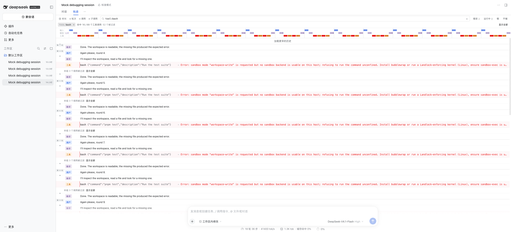
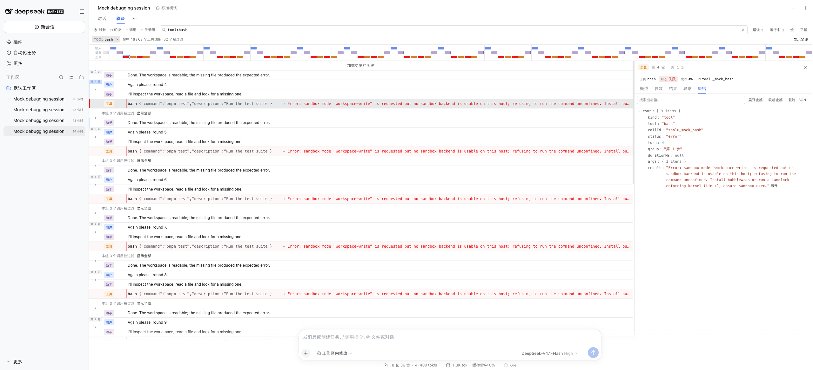

# Better Trajectory

把 DSH 内置的「轨迹」页签换成一个 Logfire 式的调试面：**一条可组合的查询**、**不塌的树**、**按记录类型分 tab 的详情**。仍然只有一个页签、一个时间轴、一套折叠——不是另起一套 UI。



## 用法

打开任意会话的 **轨迹** 页签，搜索框里输入 token：

| token | 含义 |
|---|---|
| `tool:bash` | 只看某个工具；`-tool:read` 排除 |
| `status:error` | `error` / `running` / `ok`，可写 `status:error\|running` |
| `turn:3` / `turn:2-5` | 单个回合或区间 |
| `ms:>1000` / `ms:<200` | 耗时阈值或区间 |
| `code:401` | 错误码 |

- 其余文字按自由文本匹配工具名 / 参数 / 结果 / 错误文本（AND）。
- 输入时给建议：工具名带调用次数、状态、回合、慢查询。
- 已选条件显示为 chip，`×` 删除，`显示全部` 清空，`Esc` 清空。
- Quick 药丸：`错误 N` / `运行中 N` / `慢`；`平铺` 只列命中的调用。
- 过滤只裁剪**工具调用**：用户、助手、上下文、回合头都保留；被隐藏的调用在组尾显示「本组 N 个调用被过滤 · 显示全部」。

## 详情


- 顶部 chips：工具、状态、回合、耗时、callId。
- 工具记录 tab：`概述 / 参数 / 结果`，失败时多一个 `异常`，始终有 `原始`。
- `异常`：红色横幅 + 错误正文 + 复制。
- `原始`：可搜索 JSON 树，展开/收起全部、复制整个 JSON、复制任意子树、长字符串与长数组分页。
- 非工具记录保留原生 rendered / source / raw 视图。



## 实现方式

- `src/vendor/trajectory/` 是内置 `@deepseek-ai/dsh-client-ui-trajectory` 的源码 fork（MIT），随包分发；查询条、右栏、行样式都在 fork 上直接改。
- 客户端入口接管原生 `trajectory` 条目的 `component`，**不新增页签**；`inject` face、图片子槽、时间轴数据仍由原生条目提供。
- 构建用 esbuild，`*.module.css` 由 postcss-modules 生成 `bt_` 前缀类名并注入 `<style>`；宿主只 external `react` / `client-store` / `ui-primitives` / `react-virtual`。

### 升级 dsh 时

1. 取新版本包的 `src/client/` 覆盖 `src/vendor/trajectory/`；
2. 重新应用三处改动：`TrajectoryToolbar` → `QueryBar`、`TrajectoryTable` 的 chips/异常/原始 tab、行内时间槽与隐藏提示；
3. 核对 `TrajectoryView` 的 props 与 `entry.inject` face。

## 已知边界

- 耗时/时间槽依赖事件里的 `callTime`；没有时间戳的会话只显示工具与状态。
- `原始` tab 目前是固定结构，不是任意事件 JSON。
- 过滤只在已加载的窗口内生效；过滤态下不触发「加载更早」。

## 安装

```bash
dsh plugin --profile web add ./dsh-better-trajectory-0.2.0.tgz
```

MIT。